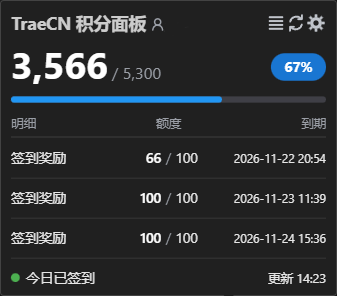

# TraeCN Quota

[简体中文](README.md) | [English](README.en.md)

Show your Trae CN credit balance in the status bar; hover to open the credit panel

## Installation

Search for **TraeCN Quota** in your editor's marketplace

You can also download the `.vsix` from [Releases](https://github.com/GhostCmdr/traecn-quota/releases/latest) and install it manually

## Notes

1. Sign in to Trae CN or TRAE SOLO CN first; the extension reads the local session directly, so there is no need to copy cookies or tokens manually
2. Only Trae CN (mainland China) accounts are supported for now; tested with Trae CN (Code and Work merged), VS Code and VSCodium
3. Manual token first: once you paste an accessToken into `traecnquota.manualToken`, the extension uses it; to go back to the client session, run the command TraeCN Quota: 清除保管箱里的手动 Token
4. The extension reads the Trae CN local session; if none is found, it silently falls back to the legacy TRAE SOLO CN session

## Features

- Status bar shows remaining credits live; click the status bar to refresh manually
- Hover panel: total remaining with percentage, per-pack detail and the current account; adapts to light and dark themes
- Open the extension settings, refresh credits, or jump to the usage page right from the panel
- Subscription packs are pinned and marked as included; the bar and percentage use three color tiers
- Scheduled auto-refresh
- Daily check-in runs automatically; click the status bar item to claim it manually

## Settings

| Setting | Default | Description |
|---|---|---|
| `traecnquota.refreshInterval` | 30 | Auto-refresh interval in minutes, 0 disables |
| `traecnquota.detailRows` | 3 | Number of packs to show, 1~6 |
| `traecnquota.planPackFirst` | true | Plan pack first: subscription pack first with an "Included" tag, unlimited packs second, others by expiry; when off, unlimited packs still go first; no plan pack is shown without a Trae subscription |
| `traecnquota.autoCheckin` | true | Daily check-in |
| `traecnquota.manualToken` | empty | Manual accessToken; entered once, moved into the encrypted secret store and this field is cleared; while set, it takes priority over the client session |
| `traecnquota.hostOverride` | empty | Debug only; accepts only `https://api.trae.cn` on the default port |

## Commands

| Command | Effect |
|---|---|
| `TraeCN Quota: 刷新积分` | Refresh the credits panel |
| `TraeCN Quota: 立即签到` | Claim today's check-in manually |
| `TraeCN Quota: 清除保管箱里的手动 Token` | Remove the manual token and go back to the client session |

## Privacy

Credentials are read only from your machine and sent only to the official `api.trae.cn` domain; nothing is logged or uploaded. The manual token is stored in the encrypted secret store, leaving no plaintext in settings

## License

[MIT](LICENSE)
