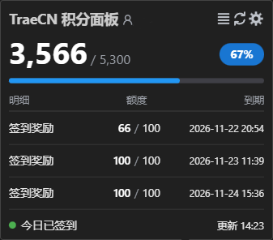

# TraeCN Quota

[简体中文](README.md) | [English](README.en.md)

在状态栏显示 Trae CN 积分额度，鼠标悬停查看积分面板浮窗

## 安装

在当前所用编辑器的扩展市场搜索 **TraeCN Quota**

也可从 [Releases](https://github.com/GhostCmdr/traecn-quota/releases/latest) 下载 `.vsix` 自行安装

## 注意事项

1. 请先在 Trae CN 客户端登录账号；插件直接从本地登录态读取，无需手动复制 Cookie 或 Token。
2. 本扩展暂时只支持 Trae CN 国内版账号，已适配 Trae CN（Code和Work合并）、VS Code、VSCodium
3. 手动 Token 优先：在设置项 `traecnquota.manualToken` 填入 accessToken 后，扩展以它为准；如需改回读取客户端登录态，请执行命令 TraeCN Quota: 清除保管箱里的手动 Token

## 功能

- 状态栏实时显示剩余积分，可点击状态栏手动刷新
- 悬停积分浮窗：剩余总量与占比 + 积分包明细 + 当前账号，已适配浅色 / 深色主题
- 可直接在浮窗中打开插件设置、刷新积分、跳转用量页
- 订阅套餐可置顶并标注「套餐内」，进度条与百分比按余量分三档变色
- 定时自动刷新
- 每天自动签到，也可点状态栏图标手动补签

## 设置

| 设置 | 默认 | 说明 |
|---|---|---|
| `traecnquota.refreshInterval` | 30 | 自动刷新间隔（分钟），0 关闭 |
| `traecnquota.detailRows` | 3 | 积分包显示数量，1~6 |
| `traecnquota.planPackFirst` | true | 订阅套餐置顶：订阅套餐排第一并标注「套餐内」，不限量包排第二，其他积分包按到期升序；关闭时不限量包仍置顶；未订阅时不会显示套餐包 |
| `traecnquota.autoCheckin` | true | 每天自动签到 |
| `traecnquota.manualToken` | 空 | 手动 accessToken，填一次即收进加密保管箱并清空本项；填了就以它为准，清除需执行命令 |
| `traecnquota.hostOverride` | 空 | 调试用，只接受默认端口上的 `https://api.trae.cn` |

## 命令

| 命令 | 作用 |
|---|---|
| `TraeCN Quota: 刷新积分` | 刷新积分面板 |
| `TraeCN Quota: 立即签到` | 手动补领今天的签到 |
| `TraeCN Quota: 清除保管箱里的手动 Token` | 清空手动 Token，回到客户端登录态 |

## 隐私

凭证只从本机读取、只发往 `api.trae.cn` 官方域，不写日志、不上传。手动 Token 存加密保管箱，settings 不留明文

## License

[MIT](LICENSE)
